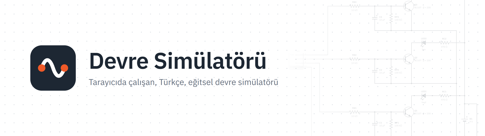
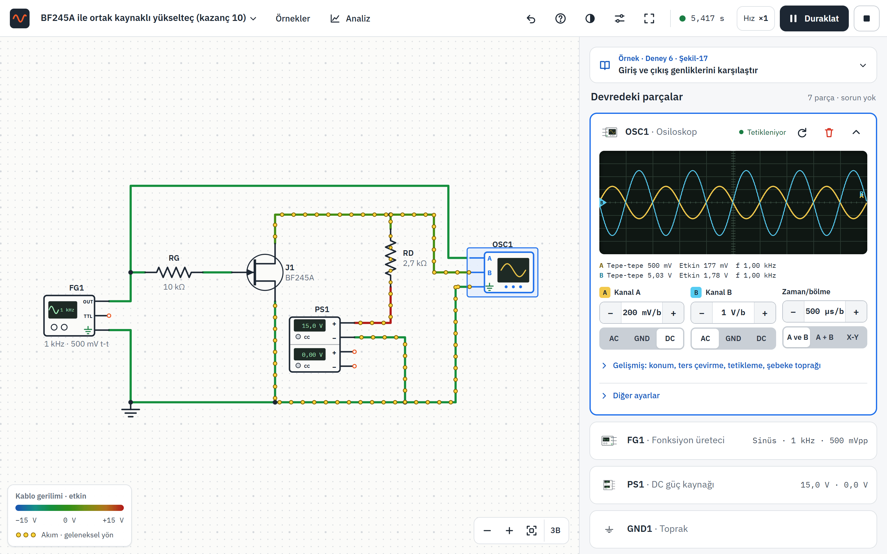
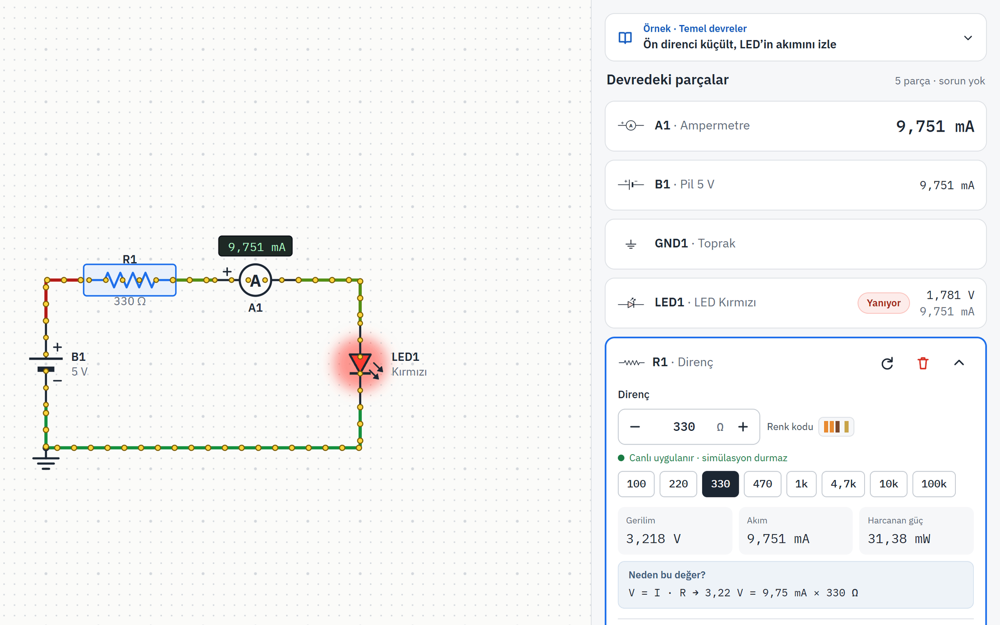
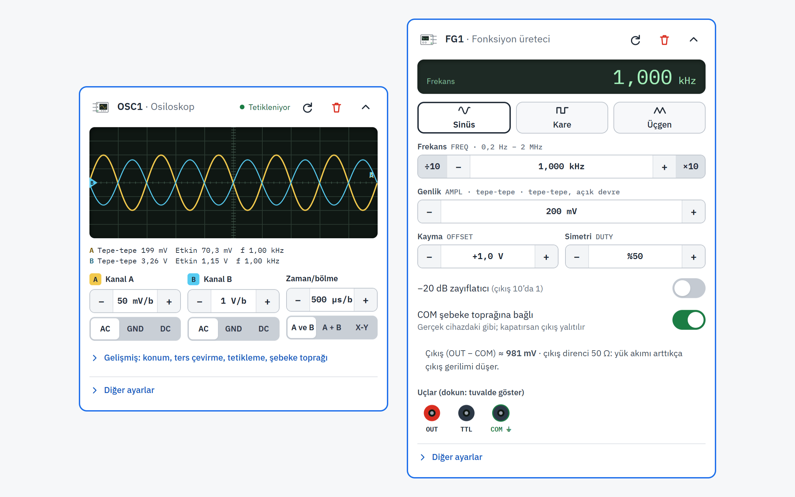
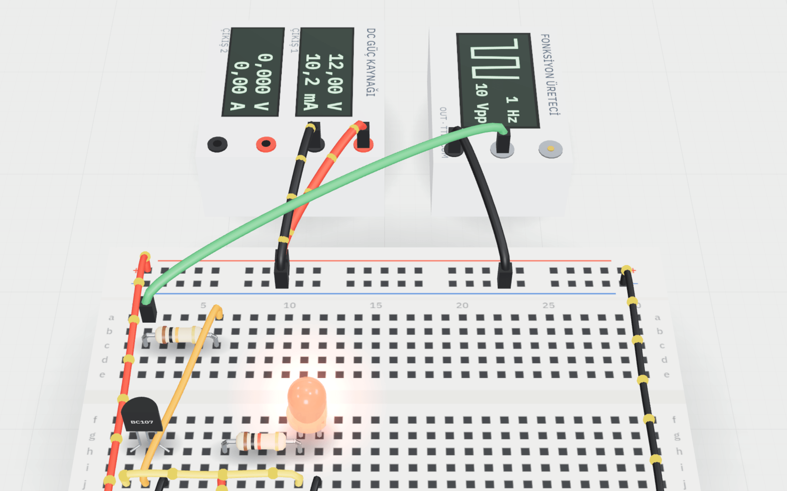
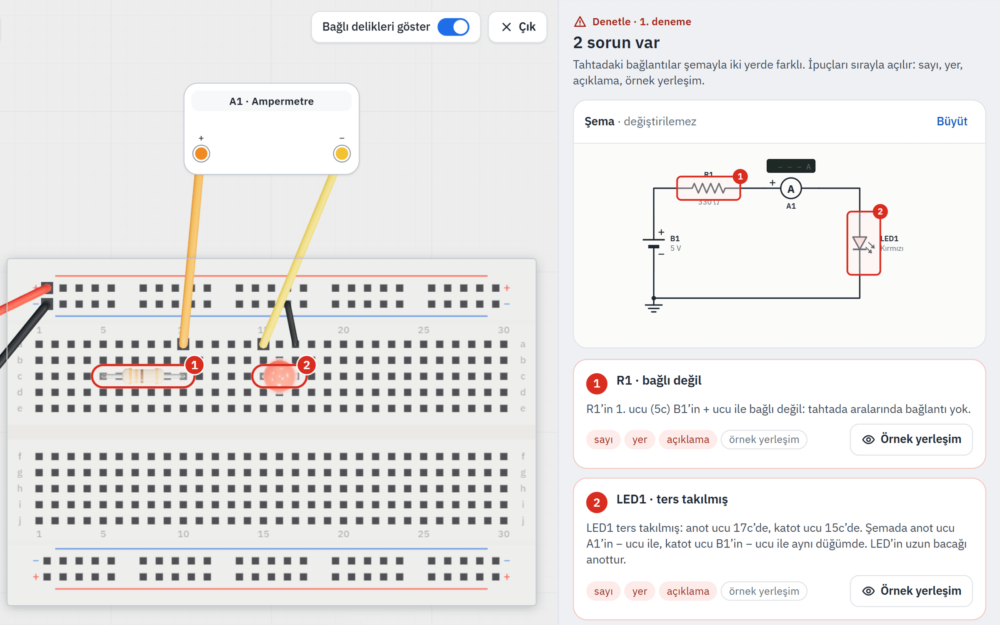
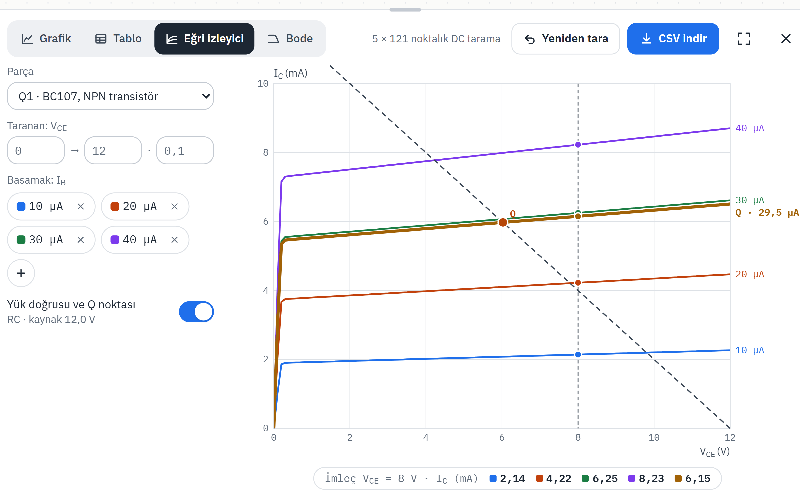
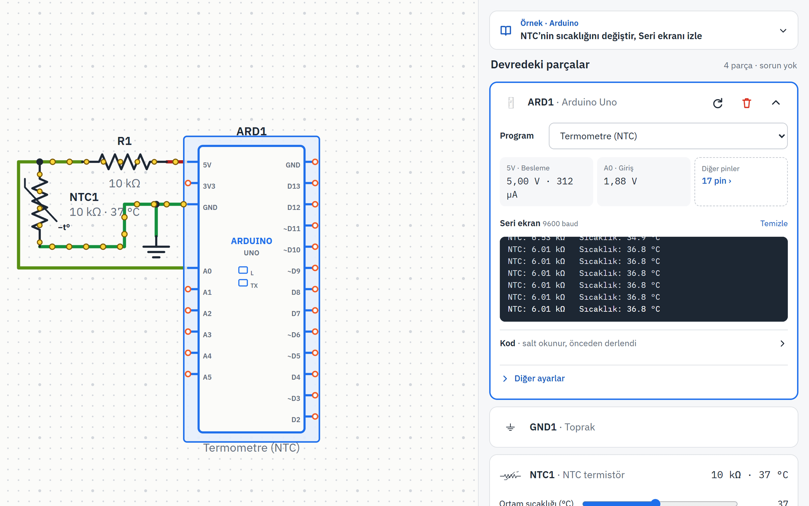
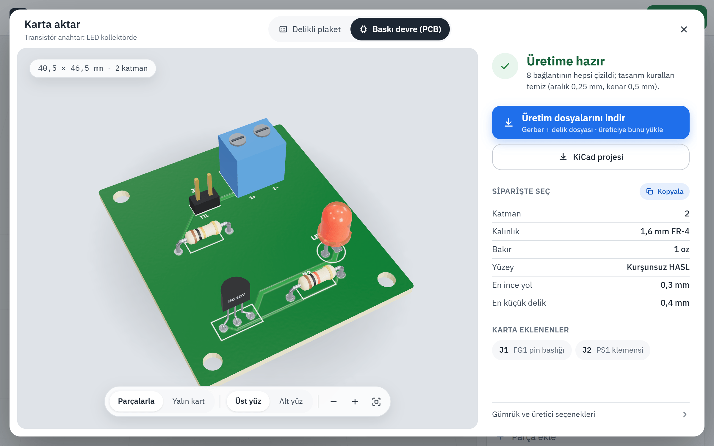
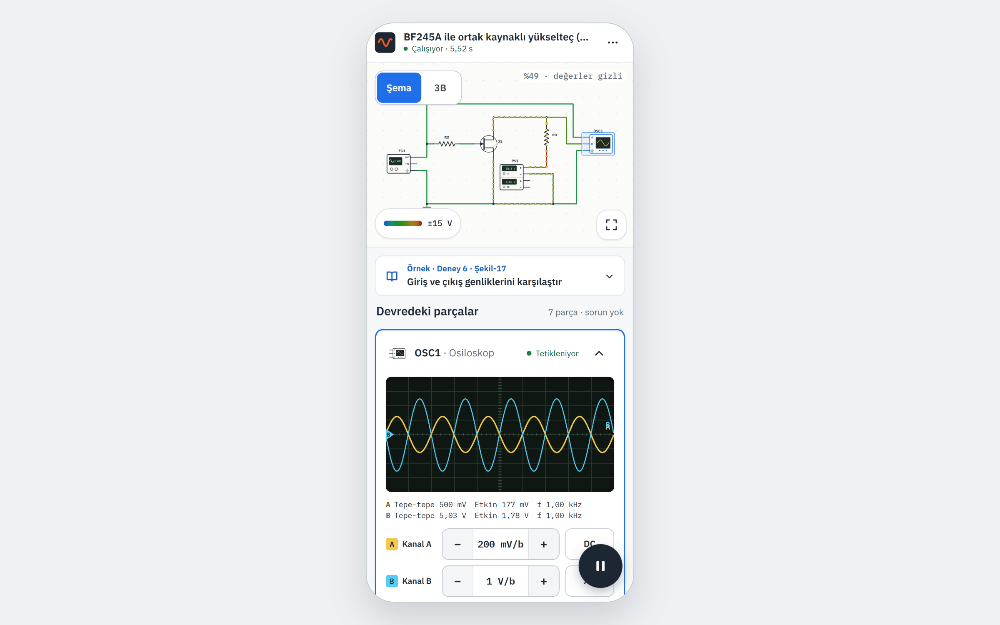

<p align="center">
  <a href="https://yigitkasap.github.io/devre-simulatoru/">
    <picture>
      <source media="(prefers-color-scheme: dark)" srcset="docs/readme/banner-dark.png">
      
    </picture>
  </a>
</p>

<p align="center">
  <b>An educational circuit simulator that runs in the browser, in Turkish.</b><br>
  Draw the schematic, press Play, see why the circuit behaves the way it does.
</p>

<p align="center">
  <a href="https://yigitkasap.github.io/devre-simulatoru/"></a>
  <a href="https://github.com/yigitkasap/devre-simulatoru/actions/workflows/deploy.yml"></a>
  
  
  
  
  
  <a href="LICENSE"></a>
</p>

<p align="center">
  <a href="https://yigitkasap.github.io/devre-simulatoru/"><b>Open the simulator</b></a> ·
  <a href="https://yigitkasap.github.io/devre-simulatoru/baraj/"><b>Dam project</b></a> ·
  <a href="#akdeniz-university-electronics-laboratory"><b>Lab experiments</b></a> ·
  <a href="README.md">Türkçe</a>
</p>

<br>

<p align="center">
  <picture>
    <source media="(prefers-color-scheme: dark)" srcset="docs/readme/ana-ekran-dark.png">
    
  </picture>
</p>

## Why?

Devre Simülatörü was built to see what will happen before you build a circuit while preparing for
the electronics lab: where the wire goes, what shows up on the oscilloscope, and why. Nothing to
install, it opens on a phone from a link, and your browser keeps your circuit. The interface is in
Turkish.

## What's inside?

<table>
  <tr>
    <td width="50%" valign="top">
      <br>
      <b>Schematic and live readings</b><br>
      Place a part, drag wires from its terminals. Every part's card shows voltage, current and power
      live; wires are colored by voltage and current dots flow.
    </td>
    <td width="50%" valign="top">
      <br>
      <b>Lab instruments</b><br>
      Function generator, dual-output DC power supply and two-channel oscilloscope: coupling, X-Y,
      A + B, peak-to-peak and frequency readouts. Even the ground loop trap works as it does in the lab.
    </td>
  </tr>
  <tr>
    <td width="50%" valign="top">
      <br>
      <b>3D bench</b><br>
      The same circuit on a desk, plugged into a breadboard. LEDs light up; instrument displays and
      oscilloscope traces are driven by the simulation.
    </td>
    <td width="50%" valign="top">
      <br>
      <b>Build on the board</b><br>
      Build the schematic on a breadboard yourself; Check points out the misplaced leg and the missing
      wire. Teachers can create an assignment link.
    </td>
  </tr>
  <tr>
    <td width="50%" valign="top">
      <br>
      <b>Analysis</b><br>
      Time plot, table, transistor curve tracer and Bode plot; downloadable as PNG and CSV.
    </td>
    <td width="50%" valign="top">
      <br>
      <b>Arduino Uno</b><br>
      The ATmega328P runs instruction by instruction (avr8js). 11 example programs; the pins are tied
      to the circuit through a real electrical model.
    </td>
  </tr>
  <tr>
    <td width="50%" valign="top">
      <br>
      <b>Export to board</b><br>
      A soldering guide for perfboard, or fabrication files for a printed circuit board (PCB); export
      to KiCad.
    </td>
    <td width="50%" valign="top">
      <br>
      <b>Phone and tablet</b><br>
      A separate layout for touch: large targets, a long-press menu, a dedicated wiring screen.
      Light and dark themes.
    </td>
  </tr>
</table>

## Akdeniz University Electronics Laboratory


The simulator was made for the Electronics Laboratory of the Department of Physics at Akdeniz
University. The circuits of the nine experiments in the lab manual are the same as the manual's
figures. Each experiment's card has the aim, theory, steps and questions; the answers are based on
numbers measured in the simulation.

1. Diode characteristics
2. Rectifiers
3. Clampers and voltage multipliers
4. Clipper circuits
5. FET characteristics
6. FET amplifier
7. Basic BJT amplifier
8. MOSFET amplifier circuit
9. Transistors as switches

Also: the **dam water level alarm** project ([lesson page](https://yigitkasap.github.io/devre-simulatoru/baraj/))
and **troubleshooting** tasks based on the lab experiments.

## Is the physics right?

The solver was written from scratch for this project and is tested on every release:

- **Nodal analysis (MNA)**, Newton-Raphson for nonlinear parts, the trapezoidal rule for capacitors
  and inductors, and an adaptive time step controlled by the local truncation error.
- **Models of the manual's parts** (1N4001, BC107, BF245A, IRF510) from the manufacturers' datasheets.
- **Physics audit:** 71 checks are compared with analytical results: Ohm, Kirchhoff, Thévenin,
  energy conservation, RC and RLC, AC phase and RMS, transistor operating points.
- **Cross-validation with ngspice:** the same circuits are also solved in ngspice and compared.
- **More than 1,600 automated tests** (Vitest) and a UI check list with hundreds of items for
  phone and desktop.

## Quick start

Requires Node.js 22.12 or later.

```bash
git clone https://github.com/yigitkasap/devre-simulatoru.git
cd devre-simulatoru
npm install
npm run dev     # http://localhost:4321/devre-simulatoru/
```

| Command | What it does |
| --- | --- |
| `npm test` | All tests (Vitest) |
| `npm run test:spice` | Cross-validation with ngspice |
| `npm run build` | Type check and static build (`dist/`) |
| `npm run ios-kontrol` | Phone and desktop UI check list (with the dev server running) |

There is no server or database: the `dist/` folder can be uploaded to any static host.

**Updating the images:** with the dev server running, run `node scripts/readme-gorselleri.mjs` (needs Edge and playwright-core); the README images are rewritten under `docs/readme/`.

## Project structure

```text
src/
  sim/        solver, part models, ATmega328P emulation (avr8js); independent of React
  model/      circuit document, connectivity, catalog
  editor/     schematic, notebook, instruments, analysis, phone layout
  bench3d/    3D bench, breadboard, PCB and KiCad export
  tahta/      build on the board: placement plan and checking
  arduino/    Arduino example programs (.ino and compiled)
  examples/   ready-made circuits (including the lab experiments)
  baraj/      dam water level alarm lesson page
  i18n/       Turkish strings and lab manual content
tests/        unit tests, physics audit, ngspice comparison
docs/         design documents, development decisions, Moodle embedding guide for teachers
```

A detailed account of the development decisions and of every part's model (in Turkish):
[docs/KARARLAR.md](docs/KARARLAR.md).

## Contributing

For bug reports and suggestions, [open an issue](https://github.com/yigitkasap/devre-simulatoru/issues).
When proposing a new part or model, include its datasheet: every number in the simulator is backed
by a source.

If you find the project useful, a star helps others find it too.

## License and credits

The code is released under the [MIT license](LICENSE): you may use, modify and distribute it; just
keep the license text and the copyright line.

The Akdeniz University logo and the content taken from the lab manual belong to their respective
owners and are not covered by the code's license (details: [NOTICE.md](NOTICE.md)). The code was
written from scratch; no other simulator's source code, name or images were used. Typeface:
IBM Plex (OFL).

<p align="center"><sub>Mehmet Yiğit Kasap · Department of Physics, Akdeniz University</sub></p>
