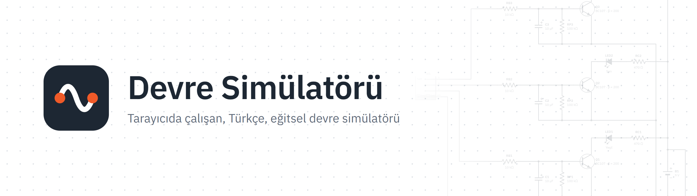
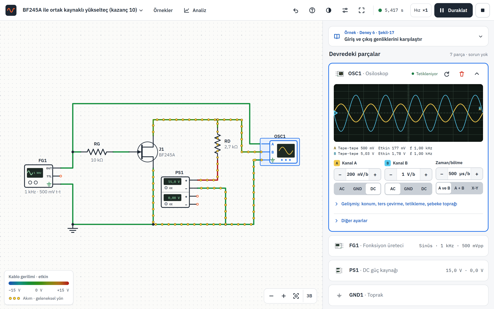
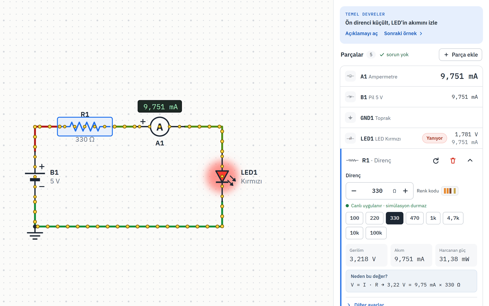
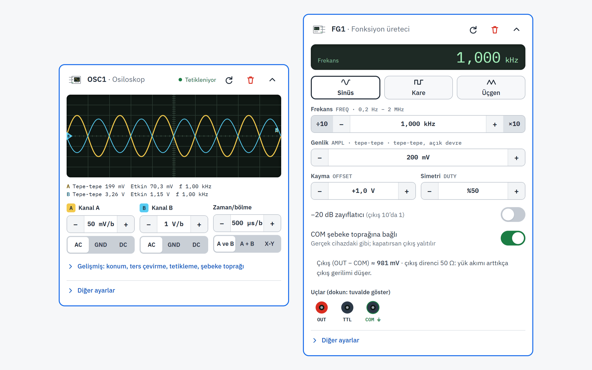
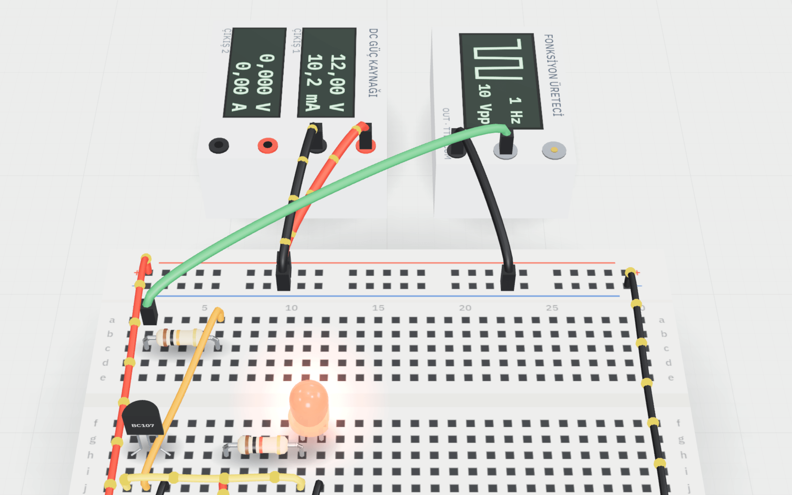
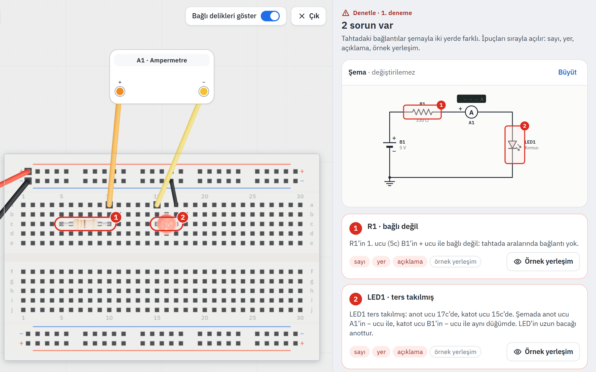
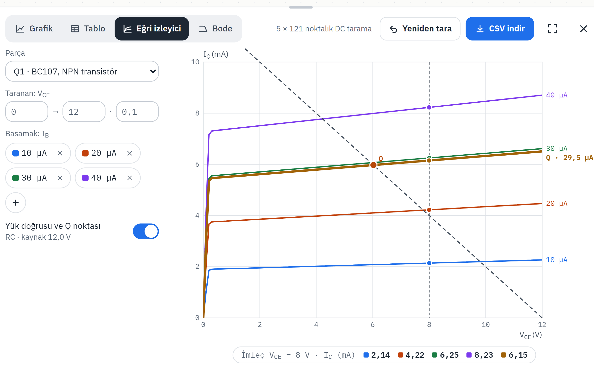
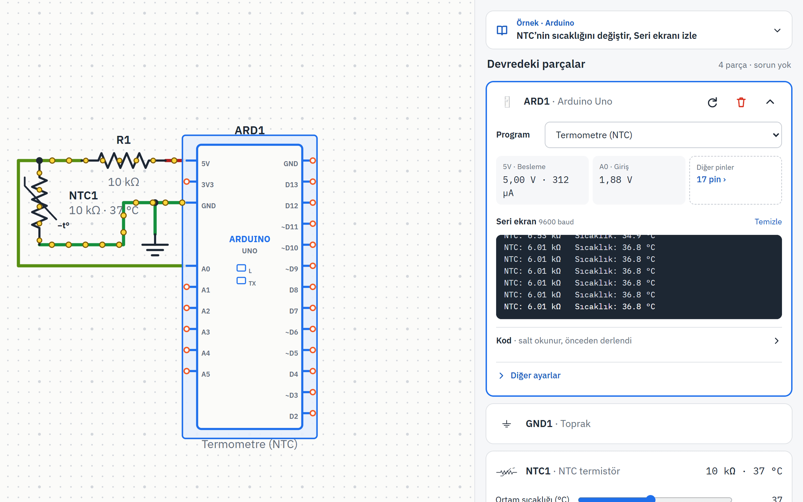
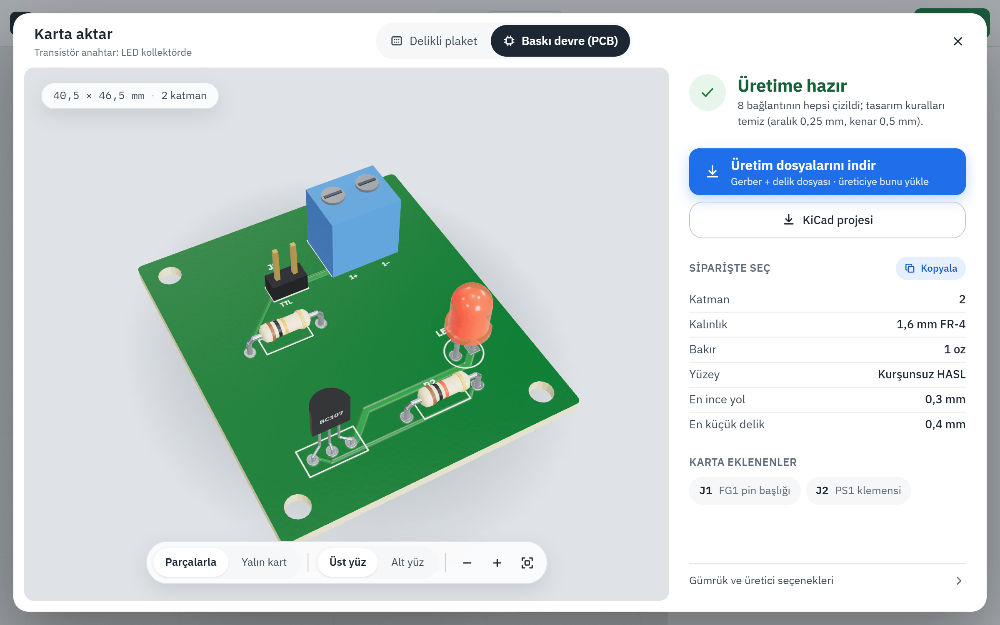
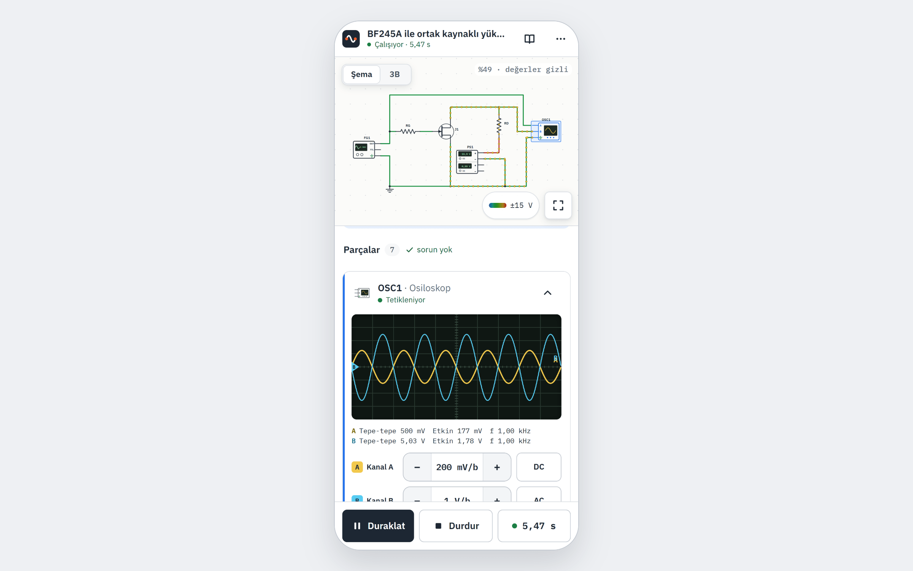

<p align="center">
  <a href="https://yigitkasap.github.io/devre-simulatoru/">
    <picture>
      <source media="(prefers-color-scheme: dark)" srcset="docs/readme/banner-dark.png">
      
    </picture>
  </a>
</p>

<p align="center">
  <b>Tarayıcıda çalışan, Türkçe, eğitsel devre simülatörü.</b><br>
  Şemayı çiz, Oynat'a bas, devrenin neden öyle davrandığını gör.
</p>

<p align="center">
  <a href="https://yigitkasap.github.io/devre-simulatoru/"></a>
  <a href="https://github.com/yigitkasap/devre-simulatoru/actions/workflows/deploy.yml"></a>
  
  
  
  
  
  <a href="LICENSE"></a>
</p>

<p align="center">
  <a href="https://yigitkasap.github.io/devre-simulatoru/"><b>Simülatörü aç</b></a> ·
  <a href="https://yigitkasap.github.io/devre-simulatoru/baraj/"><b>Baraj projesi</b></a> ·
  <a href="#akdeniz-üniversitesi-elektronik-laboratuvarı"><b>Föy deneyleri</b></a> ·
  <a href="README.en.md">English</a>
</p>

<br>

<p align="center">
  <picture>
    <source media="(prefers-color-scheme: dark)" srcset="docs/readme/ana-ekran-dark.png">
    
  </picture>
</p>

## Neden?

Devre Simülatörü, elektronik laboratuvarına hazırlanırken devreyi kurmadan önce ne olacağını görmek
için yapıldı: kablo nereye bağlanır, osiloskopta ne çıkar, neden öyle çıkar. Kurulum gerektirmez,
bir bağlantıyla telefonda da açılır, devreni tarayıcın kaydeder.

## Neler var?

<table>
  <tr>
    <td width="50%" valign="top">
      <br>
      <b>Şema ve canlı ölçüm</b><br>
      Parçayı yerleştir, uçlarından kablo çek. Her parçanın kartında gerilim, akım ve güç canlı akar;
      kablolar gerilime göre renk alır, akım noktaları akar.
    </td>
    <td width="50%" valign="top">
      <br>
      <b>Laboratuvar cihazları</b><br>
      Fonksiyon üreteci, iki çıkışlı DC güç kaynağı ve iki kanallı osiloskop: kuplaj, X-Y, A + B,
      tepe-tepe ve frekans ölçümü. Toprak tuzağı bile laboratuvardaki gibi.
    </td>
  </tr>
  <tr>
    <td width="50%" valign="top">
      <br>
      <b>3B tezgâh</b><br>
      Aynı devre bir masada, breadboard'a takılı. LED'ler yanar, cihaz ekranları ve osiloskop izleri
      simülasyonla canlıdır.
    </td>
    <td width="50%" valign="top">
      <br>
      <b>Tahtada kur</b><br>
      Şemadaki devreyi breadboard'da kendin kur; Denetle yanlış takılan bacağı ve eksik kabloyu
      gösterir. Öğretmen görev bağlantısı oluşturabilir.
    </td>
  </tr>
  <tr>
    <td width="50%" valign="top">
      <br>
      <b>Analiz</b><br>
      Zaman grafiği, tablo, transistör eğri izleyicisi ve Bode çizimi; PNG ve CSV olarak indirilebilir.
    </td>
    <td width="50%" valign="top">
      <br>
      <b>Arduino Uno</b><br>
      ATmega328P komut komut çalışır (avr8js). 11 örnek program; pinler devreye gerçek elektriksel
      modelle bağlı.
    </td>
  </tr>
  <tr>
    <td width="50%" valign="top">
      <br>
      <b>Karta aktar</b><br>
      Delikli plaket için lehim rehberi ya da baskı devre (PCB) üretim dosyaları; KiCad'e aktarım.
    </td>
    <td width="50%" valign="top">
      <br>
      <b>Telefon ve tablet</b><br>
      Dokunmatik için ayrı düzen: büyük hedefler, basılı tutma menüsü, ayrı kablo bağlama ekranı.
      Açık ve koyu tema.
    </td>
  </tr>
</table>

## Akdeniz Üniversitesi Elektronik Laboratuvarı


Simülatör, Akdeniz Üniversitesi Fizik Bölümü'nün Elektronik Laboratuvarı için hazırlandı. Föydeki
dokuz deneyin devreleri föydeki şekillerin parçaları ve değerleriyle kuruludur; her deneyin amacı,
teorik bilgisi, adımları ve soruları simülasyonda ölçülen sayılarla cevaplanmış olarak deney
kartında durur.

1. Diyot karakteristiklerinin incelenmesi
2. Doğrultucular
3. Kenetleyici ve gerilim katlayıcılar
4. Kırpıcı devreler
5. FET karakteristiklerinin incelenmesi
6. FET yükselteci
7. BJT'li temel yükselteç
8. MOSFET'li yükselteç devresi
9. Transistörlerin anahtar olarak kullanılması

Ayrıca: **baraj su seviyesi uyarısı** projesi ([ders sayfası](https://yigitkasap.github.io/devre-simulatoru/baraj/))
ve föydeki deneylere dayanan **arıza bulma** görevleri.

## Fizik doğru mu?

Çözücü bu proje için sıfırdan yazıldı ve her sürümde sınanıyor:

- **Düğüm analizi (MNA)**, doğrusal olmayan parçalar için Newton-Raphson, kondansatör ve bobin için
  yamuk kuralı, yerel kesme hatası denetimli uyarlanır zaman adımı.
- **Föydeki parçaların modelleri** (1N4001, BC107, BF245A, IRF510) üreticilerin veri sayfalarından.
- **Fizik denetimi:** 71 kontrol analitik sonuçla karşılaştırılır: Ohm, Kirchhoff, Thévenin, enerji
  korunumu, RC ve RLC, AC faz ve etkin değer, transistör çalışma noktaları.
- **ngspice ile çapraz doğrulama:** aynı devreler ngspice'ta da çözülüp karşılaştırılır.
- **1 600'den fazla otomatik test** (Vitest) ve telefon/masaüstü için yüzlerce maddelik arayüz denetimi.

## Hızlı başlangıç

Node.js 22.12 ya da üstü gerekir.

```bash
git clone https://github.com/yigitkasap/devre-simulatoru.git
cd devre-simulatoru
npm install
npm run dev     # http://localhost:4321/devre-simulatoru/
```

| Komut | Ne yapar |
| --- | --- |
| `npm test` | Bütün testler (Vitest) |
| `npm run test:spice` | ngspice ile çapraz doğrulama |
| `npm run build` | Tür denetimi ve statik derleme (`dist/`) |
| `npm run ios-kontrol` | Telefon ve masaüstü arayüz denetimi (dev sunucusu açıkken) |

Sunucu ya da veritabanı yoktur: `dist/` klasörü herhangi bir statik hostinge yüklenebilir.

**Görselleri güncellemek:** dev sunucusu açıkken `node scripts/readme-gorselleri.mjs` çalıştır (Edge ve playwright-core gerekir); README görselleri `docs/readme/` altına yeniden yazılır.

## Proje yapısı

```text
src/
  sim/        çözücü, parça modelleri, ATmega328P öykünmesi (avr8js); React'ten bağımsız
  model/      devre belgesi, bağlantılar, katalog
  editor/     şema, defter, cihazlar, analiz, telefon düzeni
  bench3d/    3B tezgâh, breadboard, PCB ve KiCad aktarımı
  tahta/      Tahtada kur: yerleşim planı ve denetim
  arduino/    Arduino örnek programları (.ino ve derlenmiş hâlleri)
  examples/   hazır devreler (föy deneyleri dahil)
  baraj/      baraj su seviyesi uyarısı ders sayfası
  i18n/       Türkçe metinler ve föy içeriği
tests/        birim testleri, fizik denetimi, ngspice karşılaştırması
docs/         tasarım belgeleri, geliştirme kararları, hocalar için Moodle'a gömme tarifi
```

Geliştirme kararlarının ve her parçanın modelinin ayrıntılı anlatımı: [docs/KARARLAR.md](docs/KARARLAR.md).

## Katkı

Hata bildirimi ve öneriler için [issue açabilirsin](https://github.com/yigitkasap/devre-simulatoru/issues).
Yeni bir parça ya da model önerirken veri sayfasını da ekle: simülatördeki her sayı bir kaynağa dayanır.

Projeyi faydalı bulduysan bir yıldız bırakman başkalarının da bulmasına yardım eder.

## Lisans ve teşekkür

Kod [MIT lisansı](LICENSE) ile yayımlanır: kullanabilir, değiştirebilir ve dağıtabilirsin; lisans
metnini ve telif satırını koruman yeterli.

Akdeniz Üniversitesi logosu ve laboratuvar föyünden alınan içerik ilgili sahiplerine aittir; kodun
lisansının kapsamında değildir (ayrıntı: [NOTICE.md](NOTICE.md)). Kod sıfırdan yazıldı; başka bir
simülatörün kaynak kodu, adı ya da görseli kullanılmadı. Yazı tipi: IBM Plex (OFL).

<p align="center"><sub>Mehmet Yiğit Kasap · Akdeniz Üniversitesi Fizik Bölümü</sub></p>
